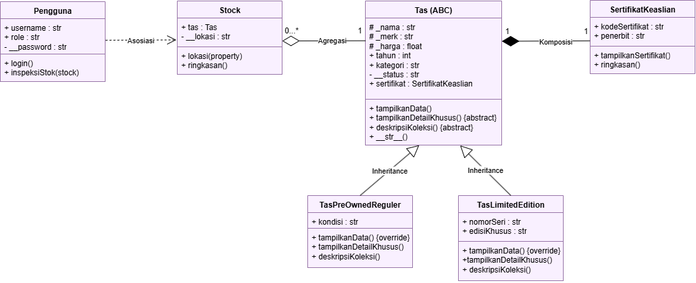
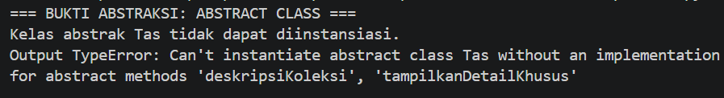
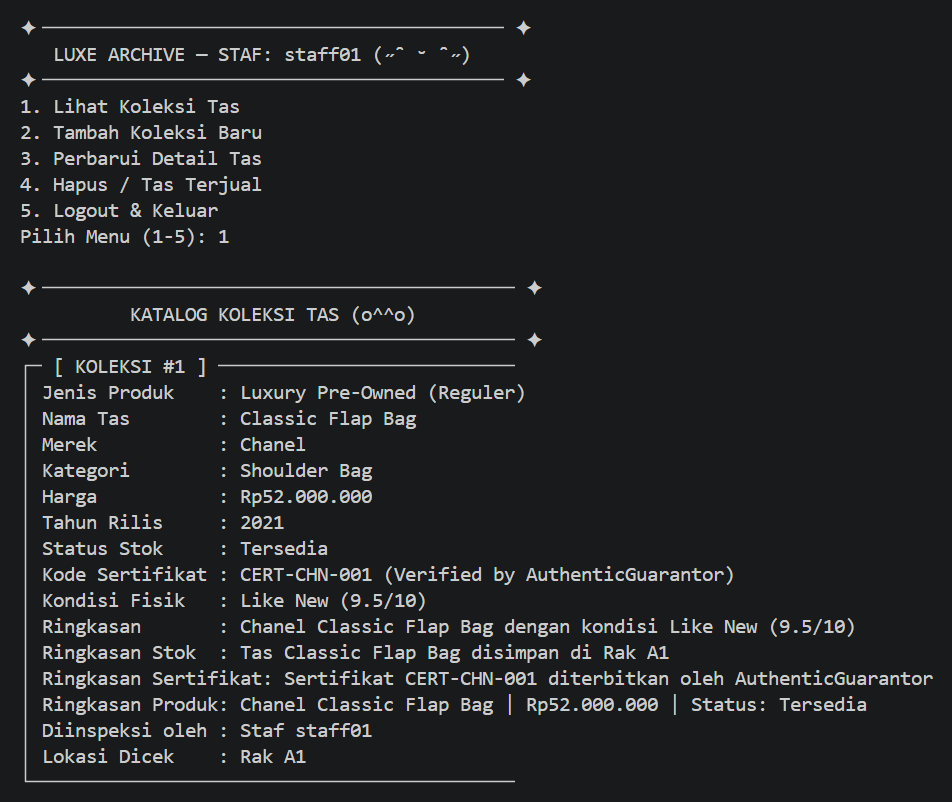
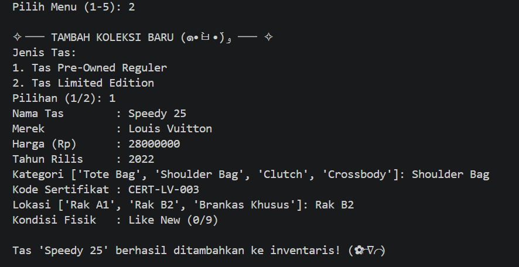
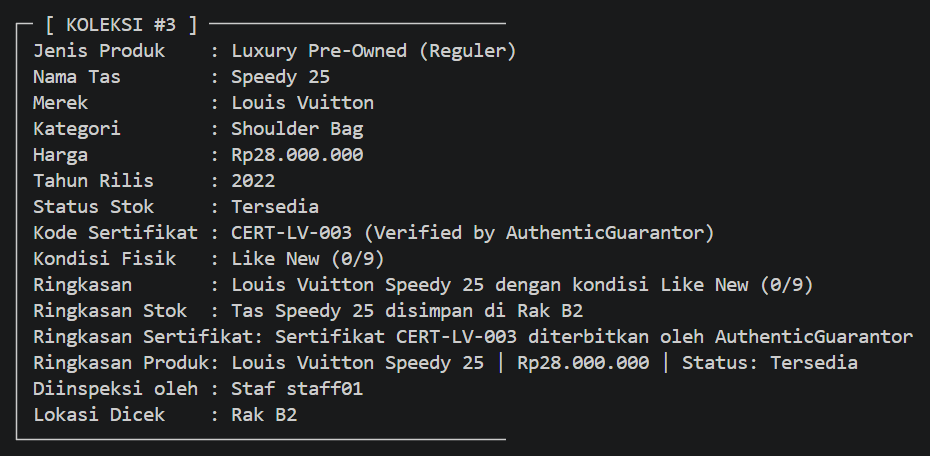
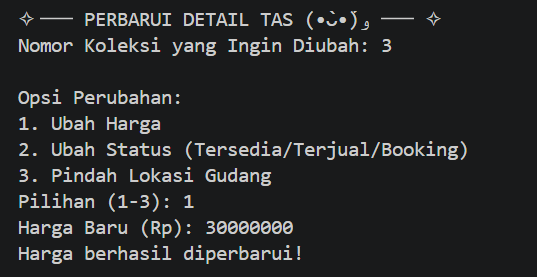
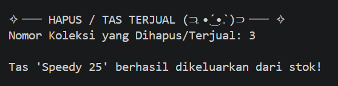

# LUXE ARCHIVE
## Sistem Manajemen Inventaris Tas Luxury Pre-Owned

Luxe Archive adalah program berbasis Python untuk mengelola inventaris tas mewah pre-owned. Program ini menerapkan konsep Pemrograman Berorientasi Objek (PBO), meliputi relasi antarkelas, inheritance, abstraksi, polimorfisme, duck typing, dan operator overloading.

## Identitas

- **Nama:** Siti Julpa
- **NIM:** 2509106080
- **Kelas:** B2'25

## Fitur Program

1. Login staf gudang.
2. Menampilkan koleksi tas beserta informasi produk dan sertifikat keaslian.
3. Menambahkan koleksi tas reguler atau limited edition.
4. Memperbarui harga, status, dan lokasi penyimpanan tas.
5. Menghapus koleksi tas dari inventaris.

## Class Diagram

Class Diagram berikut menunjukkan struktur kelas, pewarisan, serta hubungan asosiasi, agregasi, dan komposisi dalam program Luxe Archive.

## Penjelasan Relasi Antar Kelas

### 1. Asosiasi

Asosiasi diterapkan antara kelas `Pengguna` dan `Stock` melalui method `inspeksiStok(stock)`. Objek `Stock` diterima sebagai parameter dan digunakan ketika staf melakukan inspeksi tanpa disimpan sebagai atribut permanen di dalam objek `Pengguna`.

### 2. Agregasi

Agregasi diterapkan antara kelas `Stock` dan `Tas`. Objek `Tas` dibuat terlebih dahulu di luar kelas `Stock`, kemudian diberikan melalui konstruktor dan disimpan pada atribut `self.tas`. Hubungan ini merupakan agregasi karena objek tas dibuat secara mandiri dan tidak dibuat langsung oleh konstruktor `Stock`.

### 3. Komposisi

Komposisi diterapkan antara kelas `Tas` dan `SertifikatKeaslian`. Objek `SertifikatKeaslian` dibuat langsung di dalam konstruktor `Tas` dan disimpan pada atribut `self.sertifikat` sebagai bagian dari objek tas.

## Penerapan Inheritance

Kelas `Tas` menjadi superclass bagi dua subclass, yaitu `TasPreOwnedReguler` dan `TasLimitedEdition`.

Kedua subclass menggunakan `super().__init__(...)` untuk memanggil konstruktor superclass sehingga atribut umum tidak perlu ditulis ulang.

Atribut tambahan setiap subclass adalah:
- `TasPreOwnedReguler`: `kondisi`.
- `TasLimitedEdition`: `nomorSeri` dan `edisiKhusus`.

Program menggunakan atribut protected seperti `_nama`, `_merek`, dan `_harga`, serta atribut private seperti `__status`, `__password`, dan `__lokasi`.

## Penerapan Abstraksi

Abstraksi diterapkan melalui kelas abstrak `Tas` yang mewarisi `ABC` dari modul `abc`.

Kelas `Tas` memiliki dua abstract method:
- `tampilkanDetailKhusus()`
- `deskripsiKoleksi()`

Kedua method tersebut wajib diimplementasikan oleh subclass. Kelas `Tas` juga memiliki method konkret `tampilkanData()` untuk menampilkan informasi umum tas.

### Bukti Abstract Class Tidak Dapat Diinstansiasi

Fungsi `bukti_abstraksi()` mencoba membuat objek secara langsung dari kelas abstrak `Tas`. Python menolak pembuatan objek tersebut dan menghasilkan `TypeError` karena abstract method belum diimplementasikan pada kelas `Tas`.

Pengujian menggunakan `try-except TypeError` agar error dapat ditangkap dan hasilnya ditampilkan tanpa menghentikan program.

## Penerapan Polimorfisme

### 1. Polimorfisme Melalui Pewarisan

Polimorfisme melalui pewarisan diterapkan dengan meng-override method `tampilkanData()` pada kelas `TasPreOwnedReguler` dan `TasLimitedEdition`.

Kedua subclass memiliki method dengan nama yang sama tetapi menampilkan informasi berbeda sesuai jenis tas. Method tersebut dipanggil melalui satu loop pada `tampilkan_stok()`, sehingga setiap objek menjalankan implementasi yang sesuai dengan subclass-nya.

### 2. Duck Typing

Duck typing diterapkan melalui method `ringkasan()` pada kelas `Stock` dan `SertifikatKeaslian`. Kedua kelas tidak memiliki hubungan pewarisan, tetapi menyediakan method dengan nama yang sama.

Fungsi `tampilkan_ringkasan(objek)` dapat memanggil method tersebut pada objek dari kedua kelas tanpa memeriksa tipe objek terlebih dahulu.

### 3. Operator Overloading

Operator overloading diterapkan melalui magic method `__str__()` pada kelas `Tas`. Method tersebut menentukan representasi teks objek tas ketika ditampilkan menggunakan `print()`.

## Screenshot Output CRUD

### 1. Read — Menampilkan Koleksi Tas

Fitur Read menampilkan daftar tas yang tersimpan dalam inventaris, termasuk informasi produk, sertifikat keaslian, lokasi gudang, dan staf yang melakukan inspeksi.

### 2. Create — Menambahkan Koleksi Tas

Fitur Create memungkinkan staf menambahkan tas reguler atau limited edition dengan mengisi informasi produk, sertifikat, dan lokasi penyimpanan.

### 3. Update — Memperbarui Detail Tas

Fitur Update memungkinkan staf mengubah harga, status, atau lokasi penyimpanan tas yang sudah terdaftar di dalam inventaris.

### 4. Delete — Menghapus Koleksi Tas

Fitur Delete memungkinkan staf menghapus tas dari daftar inventaris. Program kemudian menampilkan pesan bahwa tas berhasil dikeluarkan dari stok.

## Penerapan Prinsip SOLID (Nilai Plus)

Prinsip SOLID yang diterapkan adalah **Liskov Substitution Principle (LSP)**. Prinsip ini menyatakan bahwa objek subclass harus dapat menggantikan objek superclass tanpa merusak perilaku program.

Penerapannya terlihat pada kelas `Tas` sebagai superclass bagi `TasPreOwnedReguler` dan `TasLimitedEdition`. Kelas `Stock` menerima objek melalui tipe dasar `Tas`, sedangkan `tampilkan_stok()` memanggil method `tampilkanData()` pada objek tas tanpa perlu membedakan subclass-nya. Kedua subclass juga mengimplementasikan abstract method yang diwajibkan oleh superclass.

## Kesimpulan

Program Luxe Archive menerapkan konsep PBO melalui relasi antarkelas, inheritance, abstraksi, polimorfisme, duck typing, dan operator overloading. Asosiasi diterapkan pada hubungan `Pengguna` dan `Stock`, agregasi pada hubungan `Stock` dan `Tas`, serta komposisi pada hubungan `Tas` dan `SertifikatKeaslian`.

Abstraksi menetapkan method yang wajib diimplementasikan oleh subclass, sedangkan polimorfisme memungkinkan objek dari subclass berbeda menjalankan perilakunya masing-masing melalui pemanggilan method yang sama. Program juga menerapkan prinsip LSP secara sederhana melalui penggunaan subclass `Tas` dalam proses pengelolaan inventaris.
